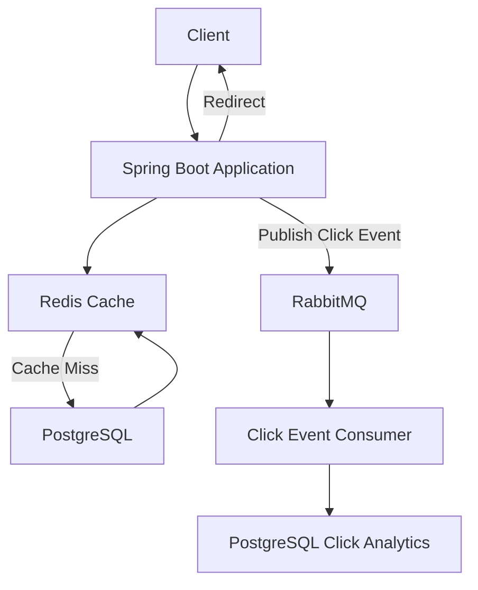

# URL Shortener

A backend URL Shortener application built using Java and Spring Boot. 
It converts long URLs into short, unique links and tracks click analytics 
using asynchronous messaging.

## Features

- Create unique short URLs
- Redirect users to original URLs
- Track click analytics
- Asynchronous click processing using RabbitMQ
- Redis caching for faster URL lookups
- Paginated analytics
- PostgreSQL database persistence
- Retry mechanism and Dead Letter Queue
- REST API documentation using Swagger
- Docker Compose support

## Technology Stack

| Technology | Purpose |
|---|---|
| Java 21 | Programming language |
| Spring Boot 4 | Backend framework |
| Spring Data JPA | Database operations |
| PostgreSQL | Persistent database |
| Redis | URL caching |
| RabbitMQ | Asynchronous click event processing |
| Flyway | Database migrations |
| Maven | Build and dependency management |
| JUnit 5 & Mockito | Unit testing |
| Docker & Docker Compose | Containerization |
| Swagger / OpenAPI | API documentation |
| Postman | API testing |

## System Architecture

The application uses Redis for caching frequently accessed URLs and RabbitMQ for asynchronous click event processing.



### What this diagram explains

1. Client requests a short URL.
2. Spring Boot checks Redis for the short URL.
3. If it's not cached, the application retrieves it from PostgreSQL.
4. The application redirects the client.
5. A click event is published to RabbitMQ.
6. A consumer processes the event and saves click analytics in PostgreSQL.

## API Endpoints

Base URL: `http://localhost:8080`

| Method | Endpoint | Description | Success Status |
|---|---|---|---|
| POST | `/api/urls` | Create a short URL | 201 Created |
| GET | `/api/urls/{shortCode}` | Redirect to original URL | 302 Found |
| GET | `/api/analytics/{shortCode}` | Retrieve click analytics | 200 OK |

### 1. Create Short URL

**Request:**
`POST /api/urls`

```json
{
  "originalUrl": "https://www.google.com"
}
```

### 2. Redirect to Original URL

**Request:**

`GET /api/urls/{shortCode}`

Returns HTTP `302 Found` with the original URL in the `Location` response header.

### 3. Retrieve Click Analytics

**Request:**

`GET /api/analytics/{shortCode}?page=0&size=10`

Returns paginated click analytics, including total clicks and click timestamps.
## Getting Started

### Prerequisites

Make sure you have installed:

- Java 21
- Docker Desktop
- Git

### 1. Clone the repository

```bash
git clone https://github.com/YOUR_USERNAME/url-shortener.git
cd url-shortener
```
### 2. Start the application

Build and start the application and its dependencies:

```bash
docker compose up -d --build
```

Remember to replace `YOUR_USERNAME` in the Git clone URL with your actual GitHub username.

### 3. Add Testing

```markdown
## Testing

The project includes unit tests using JUnit 5 and Mockito, along with integration tests.

Run the tests using:

```bash
mvn test
```
My integration tests require PostgreSQL, Redis, and RabbitMQ, start those dependencies before running the tests.

### 4. Add Postman Collection

```markdown
## Postman Collection

A Postman collection is included in the repository:

`urlshortener.postman_collection.json`

Import this file into Postman to test the API endpoints.
