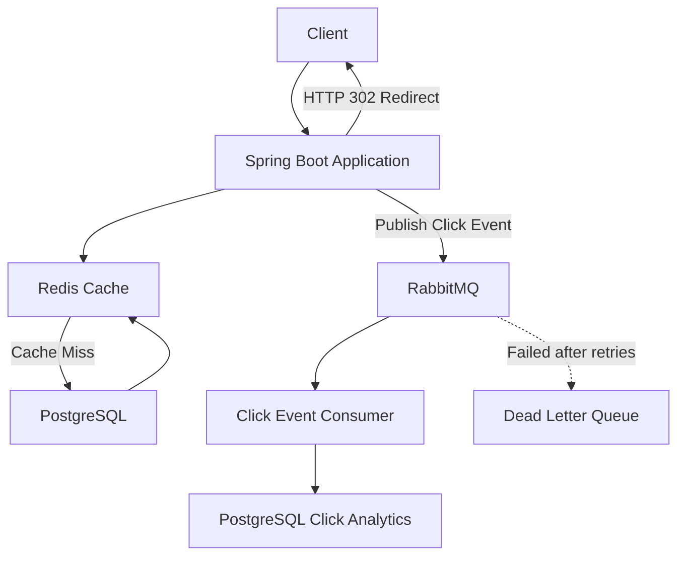

# URL Shortener

A backend URL Shortener application built using **Java 21 and Spring Boot 4**. The application converts long URLs into short, unique links and provides click analytics through asynchronous event processing.

Built to demonstrate backend development concepts including REST APIs, caching, asynchronous messaging, database persistence, pagination, and containerization.

## Live Demo

- **Live Application:** https://url-shortener-api-6o4m.onrender.com
- **Swagger API Documentation:** https://url-shortener-api-6o4m.onrender.com/swagger-ui/index.html
- **GitHub Repository:** https://github.com/sujanchaudhary415/Url-Shortener

> Note: The application is hosted on free-tier infrastructure. The first request after inactivity may take some time because the service can sleep.

## Key Features

- Generate unique short URLs using secure random code generation.
- Redirect users to their original URLs using HTTP 302.
- Redis caching for faster URL lookups.
- Asynchronous click event processing using RabbitMQ.
- Click analytics with paginated results.
- PostgreSQL persistence using Spring Data JPA.
- Database schema versioning and migrations using Flyway.
- Automatic retry mechanism for failed message processing.
- Dead Letter Queue (DLQ) for messages that fail after retries.
- Request validation and centralized exception handling.
- REST API documentation using Swagger / OpenAPI.
- Unit and integration testing using JUnit 5 and Mockito.
- Dockerized application with Docker Compose support.

## Technology Stack

| Technology | Purpose |
|---|---|
| Java 21 | Programming language |
| Spring Boot 4 | Backend framework |
| Spring Data JPA | Database operations |
| PostgreSQL | Persistent data storage |
| Redis | Caching frequently accessed URLs |
| RabbitMQ | Asynchronous event processing |
| Flyway | Database schema migrations |
| Maven | Build and dependency management |
| JUnit 5 | Unit and integration testing |
| Mockito | Mocking dependencies |
| Docker | Application containerization |
| Docker Compose | Local development environment |
| Swagger / OpenAPI | API documentation |
| Postman | API testing |

## System Architecture

The application uses Redis to cache frequently accessed short URLs and RabbitMQ to process click events asynchronously.



### Request Flow

1. A client requests a short URL.
2. Spring Boot checks Redis for the corresponding URL.
3. On a cache miss, the application retrieves the URL from PostgreSQL.
4. The application redirects the client to the original URL.
5. A click event is published to RabbitMQ.
6. A separate consumer processes the event and stores click analytics in PostgreSQL.
7. Failed message processing is handled through retries and a Dead Letter Queue.

## REST API Endpoints

### Base URLs

**Local:**
`http://localhost:8080`

**Production:**
`https://url-shortener-api-6o4m.onrender.com`

| Method | Endpoint | Description | Status |
|---|---|---|---|
| POST | `/api/urls` | Create a short URL | 201 Created |
| GET | `/api/urls/{shortCode}` | Redirect to original URL | 302 Found |
| GET | `/api/analytics/{shortCode}` | Retrieve click analytics | 200 OK |

### 1. Create Short URL

**Endpoint:** `POST /api/urls`

Request:

```json
{
  "originalUrl": "https://www.google.com"
}
```

Creates a short URL and returns the generated short code.

### 2. Redirect to Original URL

**Endpoint:** `GET /api/urls/{shortCode}`

Returns HTTP `302 Found` with the original URL in the `Location` response header.

### 3. Retrieve Click Analytics

**Endpoint:** `GET /api/analytics/{shortCode}?page=0&size=10`

Returns paginated click analytics, including:

- Short code
- Total clicks
- Total pages
- Current page
- Page size
- Click timestamps

## Getting Started

### Prerequisites

Make sure you have installed:

- Java 21
- Docker Desktop
- Git

### 1. Clone the Repository

```bash
git clone https://github.com/sujanchaudhary415/Url-Shortener.git
cd Url-Shortener/url-shortener
```

### 2. Start the Application

Build and start the application and its dependencies using Docker Compose:

```bash
docker compose up -d --build
```

This starts:

- Spring Boot application
- PostgreSQL
- Redis
- RabbitMQ

### 3. Access the Application

| Service | URL |
|---|---|
| Application | http://localhost:8080 |
| Swagger UI | http://localhost:8080/swagger-ui/index.html |
| RabbitMQ Management | http://localhost:15672 |

### 4. Stop the Application

```bash
docker compose down
```

Docker volumes preserve database and service data when containers are stopped this way.

## Testing

The project includes unit tests using JUnit 5 and Mockito, along with integration tests.

Run the test suite using:

```bash
mvn test
```

Integration tests require the relevant PostgreSQL, Redis, and RabbitMQ services to be running.

## Postman Collection

A Postman collection is included in the repository:

`Url-Shortener.postman_collection.json`

Import this collection into Postman to test the available API endpoints.

## Deployment

The application is deployed using:

- Render for the Spring Boot application and PostgreSQL database.
- Render Key Value for Redis-compatible caching.
- CloudAMQP for hosted RabbitMQ messaging.
- Docker for building and packaging the application.

Production configuration is supplied through environment variables rather than hardcoded production credentials.

## Author

**Sujan Chaudhary**

GitHub: https://github.com/sujanchaudhary415
